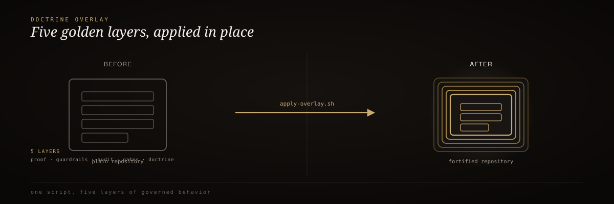

<div align="center">
  
</div>

<br/>

<div align="center">
  <h3>RIG Doctrine Overlay</h3>
  <p><em>Make any AI repo 1000x governed.</em></p>
</div>

<div align="center">


</div>

<br/>

> 🥇 Point this at any existing AI/ML repository — a guardrails library, an eval framework, an agent runtime, anything — and it drops in a five-layer governance overlay that converts "code that an agent can edit" into an **FDE-standard repo**: doctrine-governed, self-hardening, independently verified, behavior-specified, and proof-gated before it ships. It never touches your source code, your license, or your CI provider. It adds files.

## 60-second install

```bash
./apply-overlay.sh <target-repo>

# preview what would change without writing anything
./apply-overlay.sh /path/to/target-repo --dry-run

# re-apply / overwrite an existing .rig/ install — idempotent, safe to re-run
./apply-overlay.sh /path/to/target-repo --force
```

That's the whole interface. One script, one argument, five layers installed.

## How it works

<div align="center">
  
</div>

<sub align="center">AGENTS.md doctrine → L10 smoke harness → L8 verification → OpenSpec BDD → ProofGates config</sub>

| Layer | File | What it does |
| :-: | :-- | :-- |
| 1 — TAC | `AGENTS.md` | Doctrine every agent reads first: Core Four, 12 Leverage Points, Builder≠Verifier, closed-loop architecture |
| 2 — L10 | `.rig/smoke.sh` | Self-evolving smoke harness: syntax → unit → integration → eval → proof; real failures become permanent planted regressions via `--learn` |
| 3 — L8 | `.rig/verify.sh` | 8 sequential, independently-runnable layers, each PASS/FAIL with printed evidence |
| 4 — OpenSpec BDD | `spec/features/*.feature` | Executable Gherkin behavior contracts — every scenario ends on a checked proof gate |
| 5 — ProofGates | `.rig/proof-gate.yml` | HMAC-signed ProofPacket config: what gets hashed, who may sign, what pass-rate threshold blocks a merge |

## Before / after

| | Before | After `./apply-overlay.sh` |
| :-- | :-- | :-- |
| README | Marketing copy, no governance signal | FDE standard header: badges, governance status table, links to every gate |
| Doctrine | None | `AGENTS.md` — every agent reads this first |
| Self-certification | An agent (or human) can claim "tests pass" without running them | `.rig/verify.sh` is the independent pass; `allow_builder_self_sign: false` blocks the builder from being the signer |
| Regressions | A fixed bug can silently return | `smoke.sh` replays every entry in `failures.json` on every subsequent run |
| Audit trail | Whatever logs happened to capture | Auditable, hash-verifiable trail of exactly what was checked before "done" |

## Why it exists

- **Governs the repo, not the developer** — five layers of structure that any agent (Claude Code, Codex, Cursor, Aider, Devin) reads and obeys
- **Builder ≠ Verifier, enforced at the config level** — `allow_builder_self_sign: false` by default, not just a doctrine suggestion
- **Auto-detects your stack** — Node, Python, Go, Rust; runs the repo's own real test/build commands, never invents tooling
- **Idempotent by design** — safe to re-run with `--force`, safe to preview with `--dry-run`

<details>
<summary><strong>The L8 verification layers</strong></summary>

<br/>

| Layer | Checks |
| :-: | :-- |
| L1 syntax | Does the code parse? |
| L2 unit | Do unit tests pass? |
| L3 integration | Does the system build/boot end-to-end? |
| L4 eval | Do `spec/features/*.feature` exist and describe real behavior? |
| L5 proof | Does a ProofPacket-shaped artifact exist? |
| L6 gate | Does the run satisfy `proof-gate.yml`'s pass-rate threshold? |
| L7 audit | Is there a human-readable trail (git history)? |
| L8 signoff | Are all prior layers green — cleared to sign? |

Runnable as a whole (`--continue` to see every layer instead of halting at the first FAIL) or one layer at a time (`--layer=N`).

</details>

<details>
<summary><strong>After the install, inside the target repo</strong></summary>

<br/>

```bash
cd /path/to/target-repo

# edit AGENTS.md's "Project Conventions" section for this repo's actual stack
$EDITOR AGENTS.md

# replace the example BDD scenario with real ones for this repo's behavior
$EDITOR spec/features/example.feature

# run the self-evolving smoke harness
.rig/smoke.sh --learn

# run the independent 8-layer verifier
.rig/verify.sh

# wire signing into CI
export RIG_PROOF_KEY=...
```

</details>

## Documentation

| Resource | Description |
| :-- | :-- |
| [`templates/AGENTS.md`](templates/AGENTS.md) | Layer 1 — TAC doctrine template |
| [`templates/smoke.sh`](templates/smoke.sh) | Layer 2 — L10 harness template |
| [`templates/verify.sh`](templates/verify.sh) | Layer 3 — L8 verification template |
| [`templates/proof-gate.yml`](templates/proof-gate.yml) | Layer 5 — ProofPacket config template |
| [`templates/feature.template.feature`](templates/feature.template.feature) | Layer 4 — BDD template |
| [`TOP-10-CANDIDATES.md`](TOP-10-CANDIDATES.md) | Target repos this overlay is built for |
| [LICENSE](LICENSE) | MIT |

---

<div align="center"><sub>Built by Mike Rodgers · Forward Deployed Engineer · <a href="https://rodgersintelligence.com">rodgersintelligence.com</a></sub></div>
